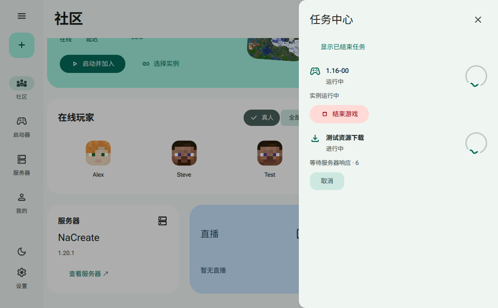
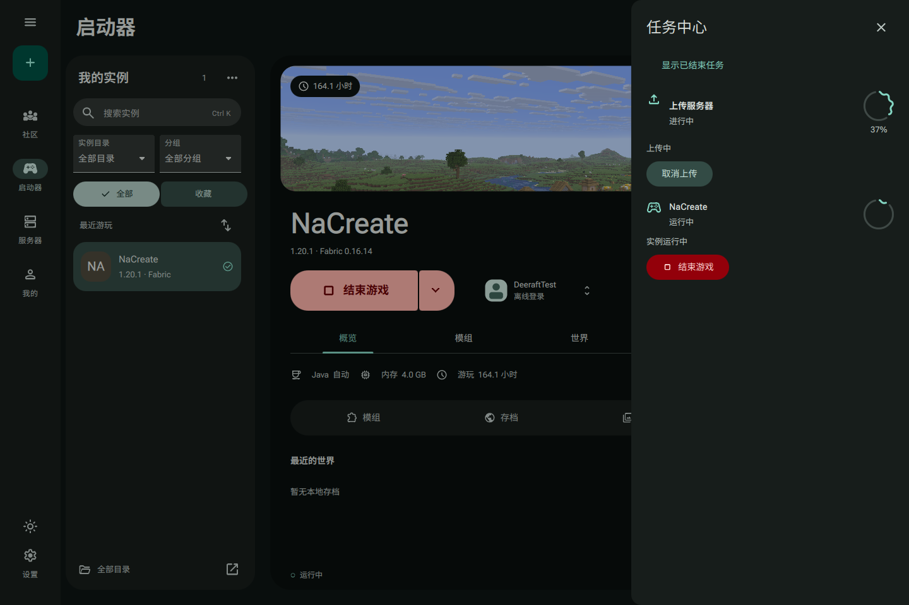

# 任务中心圆形进度 · 2026-10-28

按用户给出的圆形波浪示例，将任务中心的线状进度全部替换为 QmlMaterial `CircularIndicator`，放在每项任务右侧，尺寸 48×48、线宽 3，沿用现有主题角色色。

- 已知进度：圆弧表示实际比例，下方显示百分比。
- 正在运行或进度未知：使用同组件的不定进度动效，不显示虚构百分比。
- 保留任务图标、状态、取消和结束游戏入口，以及减少动态效果设置。

原生 `verify-polish.ps1` 与 `verify-repairs.ps1` 均通过。实际运行截图覆盖浅色未知进度与深色已知进度；37% 上传的组件实际值和显示值均为 0.37，两个圆形组件均为 48×48，动画状态为运行。窗口未向真实桌面曝光，因此截图和原生状态检查不能替代真人对前台动画流畅度的观察。

便携包：`Desktop/dist/DeeraftApp-win64-20261028-215924.zip`。SHA-256：`4C4E369918ECC7D3ADD0270546FCF24B9E69F4475E8AF389677B5B1D6EB7B680`。
